# Derriba al escuadrón

Láminas diana de **139 × 139 mm** (como mucho 3 mm de alto) para imprimir en 3D y tirar con balines. Cada avión es un hueco con una diana dentro, sujeta solo por una pestaña fina: un impacto la arranca y el avión queda derribado. Cuanto más pequeña es la diana, más puntos vale.

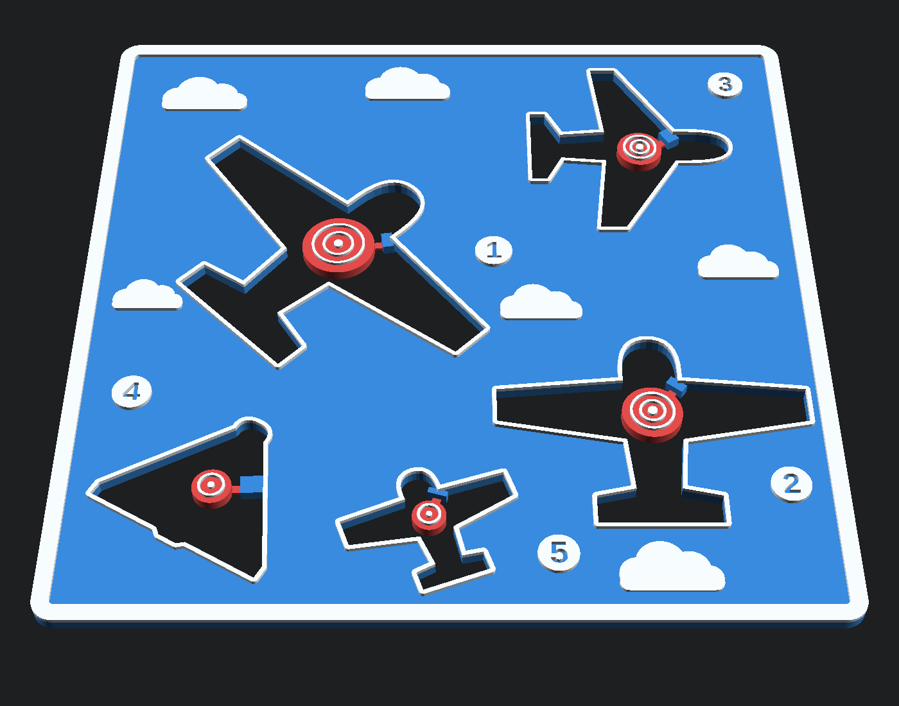

## Diseños

### Escuadrón de aviones · `aviones/B-escuadron.scad`

Cinco aviones de tamaños distintos sobre un cielo con nubes, marco y números en relieve. Hay dos disposiciones: **clásica** (en desbandada) y **flecha** (en formación). Con la opción de **diana inversa**, cuanto más grande es el avión, más pequeña es su diana.

| Clásica | Flecha | Flecha con diana inversa |
|---|---|---|
|  | 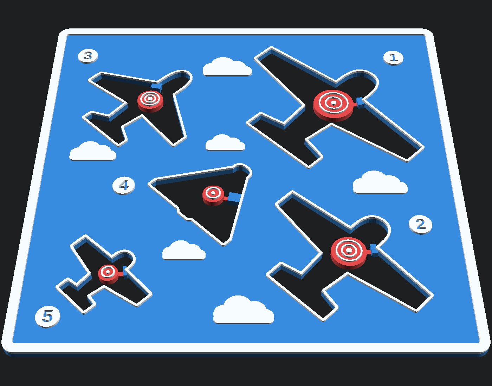 | 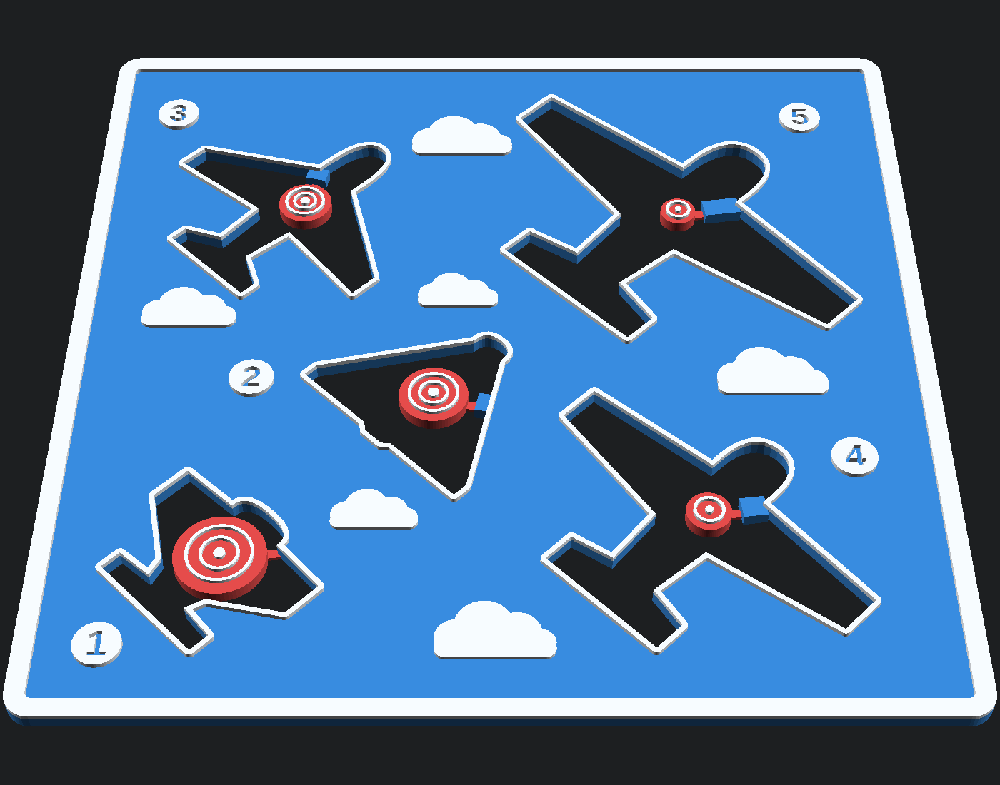 |

Cada diseño tiene tres versiones:

| Normal | Express | Mínima |
|---|---|---|
|  | 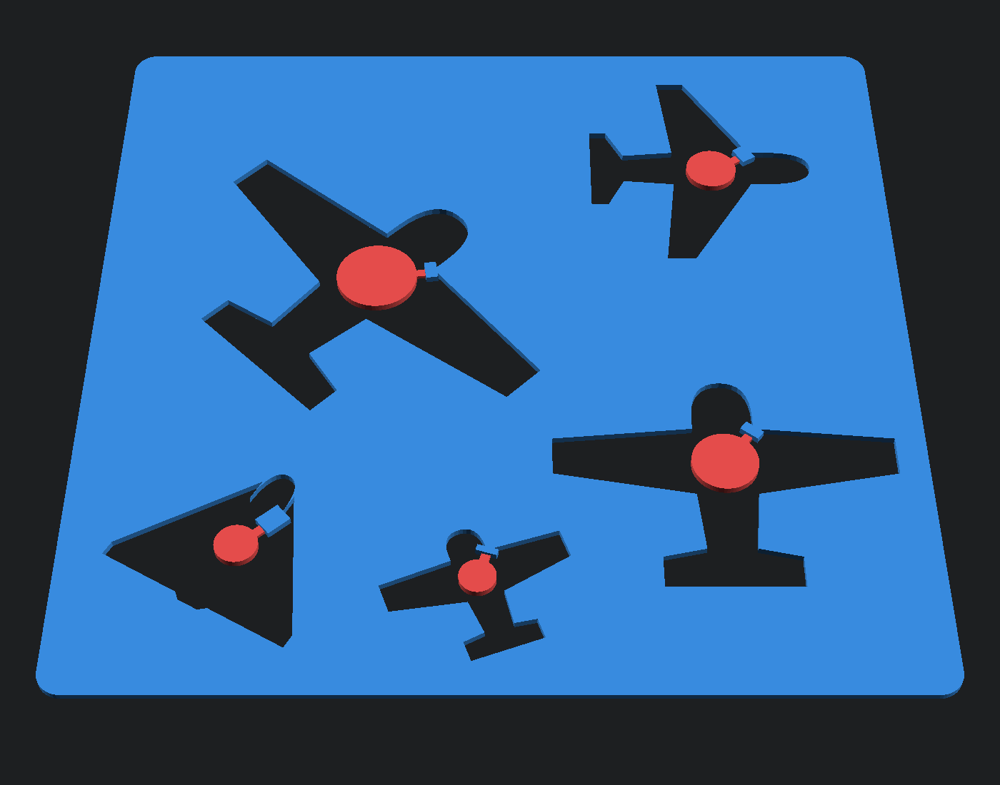 | 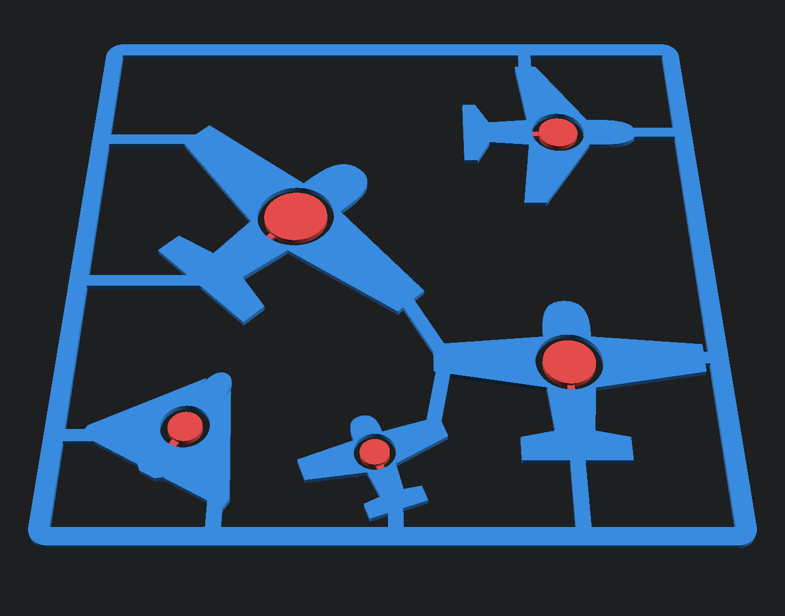 |
| Con relieve: marco, nubes, rebordes y números | Lisa y fina, se imprime rápido | Solo los aviones y el marco, el cielo queda vacío |

### 3 contra 3 · `aviones/C-3contra3.scad`

Dos escuadrones enfrentados, cada uno con un bombardero, un caza y una avioneta. El escuadrón B es el A girado 180°, así que los dos jugadores ven la misma lámina desde su lado. Las dianas e insignias del bando A son rojas y las del B, azul marino. Una línea de frente en relieve separa los dos bandos.

| Frente: cara a cara | Esquinas: en abanico |
|---|---|
| 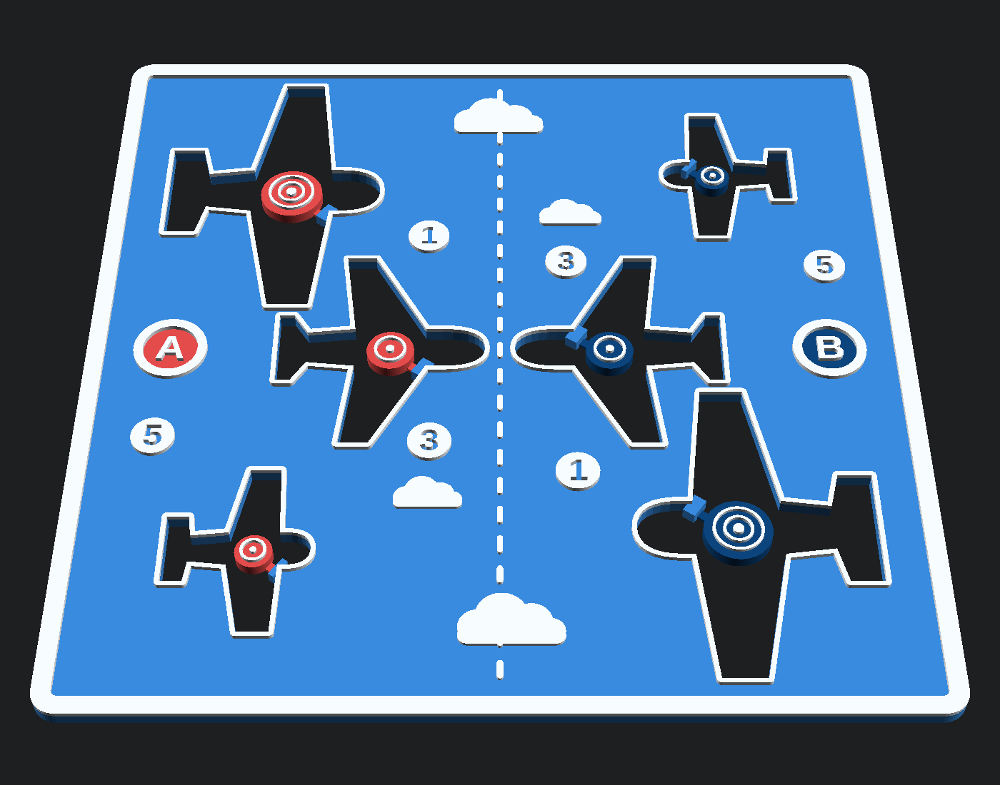 | 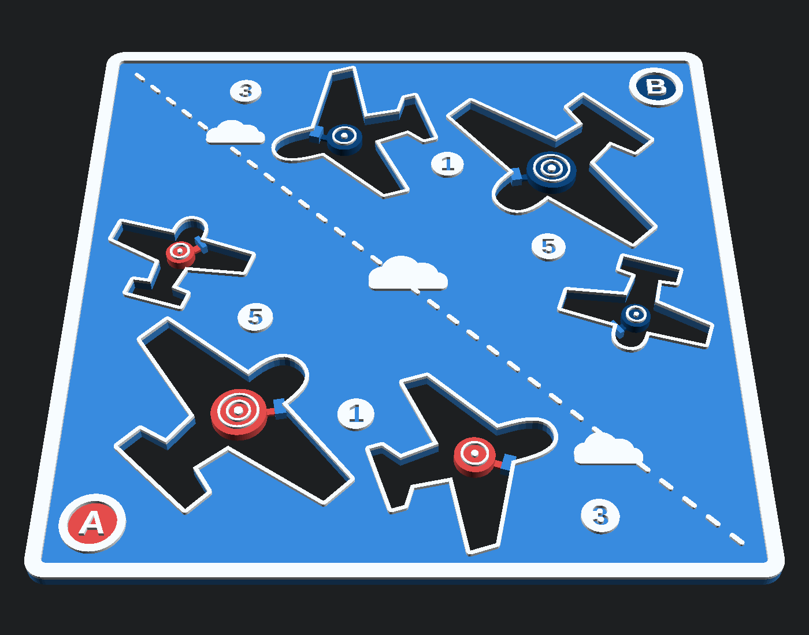 |
| 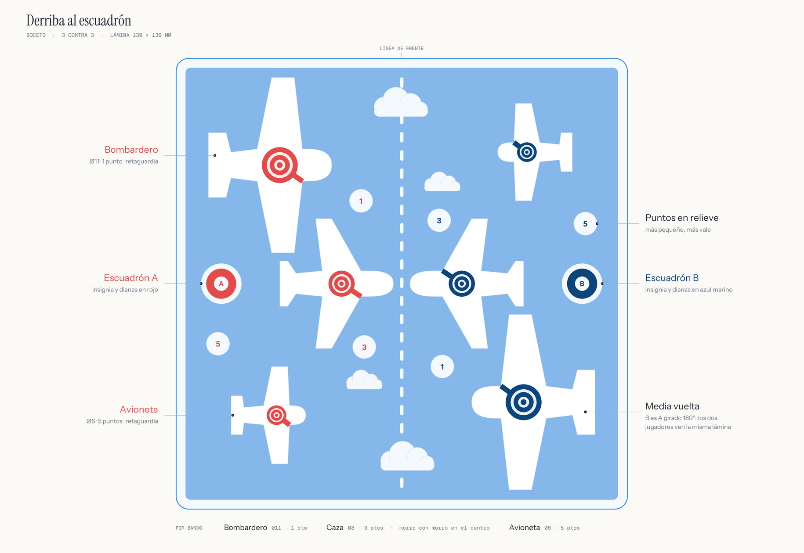 | 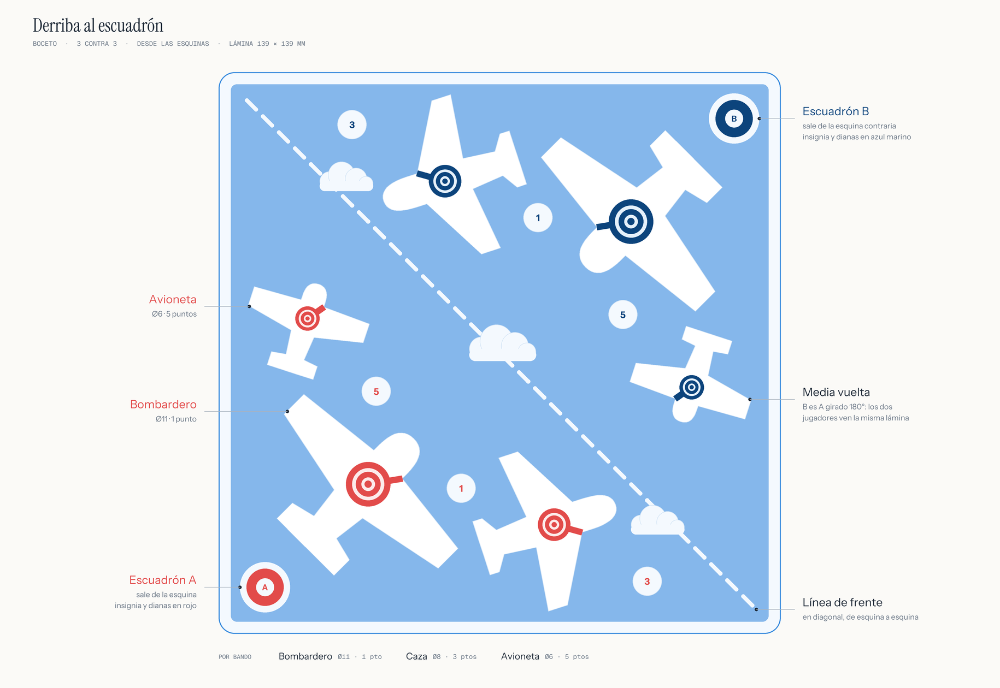 |

### Fondo de cielo para la versión mínima

La versión mínima deja el cielo vacío. Este fondo se imprime en láser a color y se pone detrás de la lámina, con las nubes en los huecos. Los PDF de `aviones/fondo-cielo/` son hojas A4 a tamaño real con marcas de corte, uno o dos fondos por hoja.

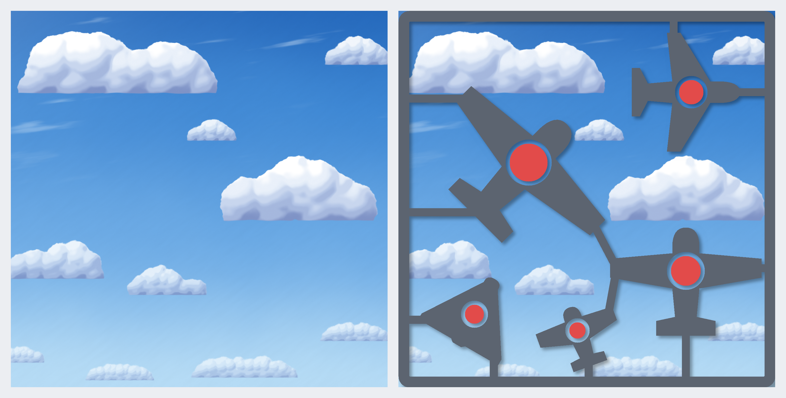

### Primeros bocetos

Pantalla de radar y escuadrón con puntos (`aviones/`), y la versión con barcos: tablero clásico y escuadra con puntos (`barcos/`). Los SVG están a escala 1:1 en milímetros.

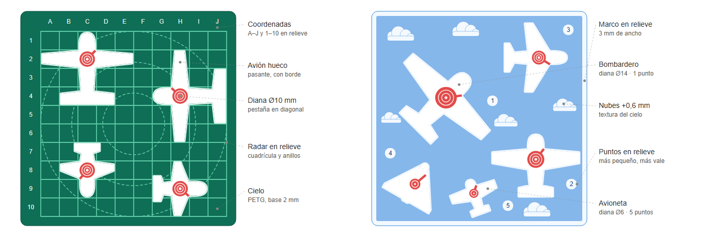
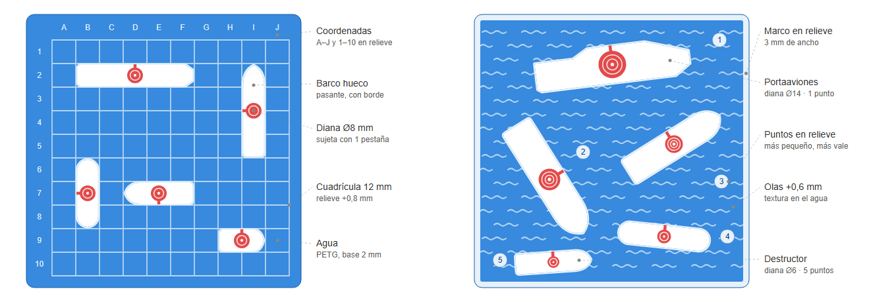

## Imprimir

Los STL ya generados están en `aviones/stl/`:

| Archivo | Para qué |
|---|---|
| `*-completa.stl` | Lámina entera en un solo cuerpo, para imprimir con un solo color |
| `*-express.stl`, `*-minima.stl` | Versiones express y mínima |
| `*-base.stl`, `*-relieve.stl`, `*-dianas*.stl` | Piezas para multimaterial: cielo, relieve y dianas (en el 3 contra 3, `dianas-a` y `dianas-b`, una por bando). Se cargan juntas como un solo objeto de varias partes |
| `probeta-pestanas*.stl` | Tira de prueba con pestañas de 0,4 a 1,0 mm, para elegir el grosor que mejor se rompe con tus balines |

La pestaña por defecto mide 0,6 × 1,5 mm (tres capas de 0,2 mm), y en `aviones/stl/` hay también variantes con pestaña de 0,8 mm (`ceroOcho`). Así se ve la diana unida a la lámina por la pestaña:

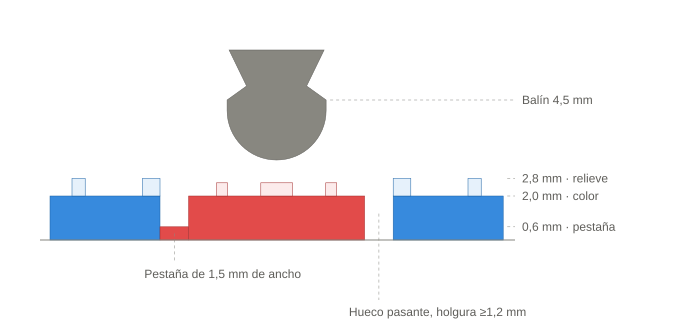

## Generar tus propias láminas

Los modelos son paramétricos y se hacen con [OpenSCAD](https://openscad.org) (probado con 2021.01). Abre el `.scad` y, en **Ventana › Personalizador**, elige:

- **parte**: la lámina completa, una pieza para multimaterial, la probeta o la vista en color;
- **versión**: normal, express o mínima;
- **disposición** y el **tipo de avión** de cada posición;
- **grosores** de la lámina y de la pestaña, **diámetros** de las dianas, **diana inversa**…

Después pulsa F6 y exporta con F7. Desde la línea de comandos:

```bash
openscad -o lamina.stl -D 'parte="completa"' -D 'disposicion="esquinas"' aviones/C-3contra3.scad
```

En la consola, el modelo informa de la diana, los puntos y el hueco de cada avión, y avisa si algo queda demasiado justo.

## Scripts (`generador/`)

Hacen falta Python 3 y Pillow. Los fondos de cielo necesitan también numpy, y `fondo_cielo_ruido.py` necesita scipy.

| Script | Qué genera |
|---|---|
| `derriba.py` | SVG 1:1 y anotados de los cuatro primeros bocetos |
| `boceto_3v3.py` | Bocetos del 3 contra 3. Avisa si dos piezas quedan a menos de 2 mm entre sí o del marco |
| `fondo_cielo.py` | Primer fondo de cielo: PNG a 600 ppp y PDF A4. La vista con la lámina necesita OpenSCAD (variable `OPENSCAD`) |
| `fondo_cielo_ruido.py` | Fondo de cielo pintado con ruido: `python fondo_cielo_ruido.py <px_por_mm> <salida.png>` |
| `hoja_a4.py` | Maquetación común de las hojas A4 (marcas de corte, instrucciones y barra de escala) |
| `seccion.py` | Corte de la diana y la pestaña (`detalle-pestana.svg`) |

Las fuentes de los bocetos están en `generador/fuentes`, con licencia SIL Open Font License.

## Versiones

| Etiqueta | Novedad |
|---|---|
| v1.0 | Primeros bocetos y modelo imprimible del escuadrón de aviones |
| v1.1 | Versiones express y mínima |
| v1.2 | Tipos de avión por tamaño y diana inversa |
| v1.3 | Los aviones engordan si su diana no cabe |
| v1.4 | Disposición en flecha |
| v2.01 | Boceto del 3 contra 3 |
| v2.02 | Modelo 3D del 3 contra 3 y disposición desde las esquinas |
